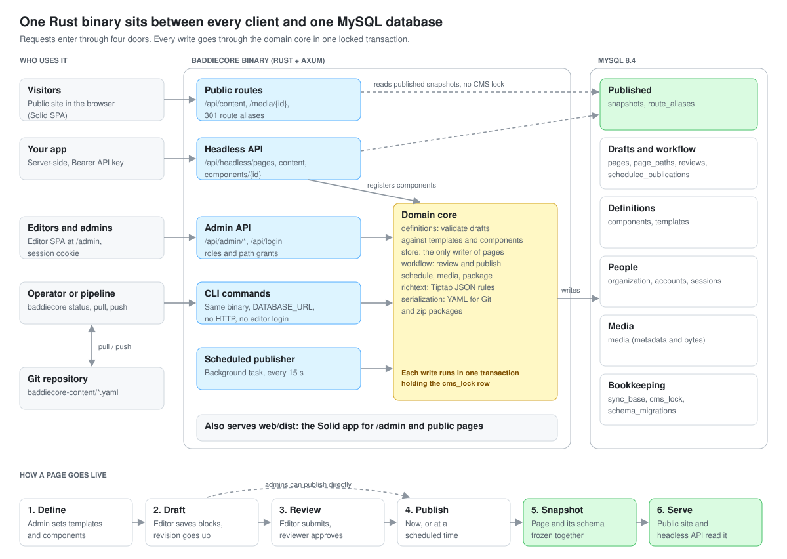
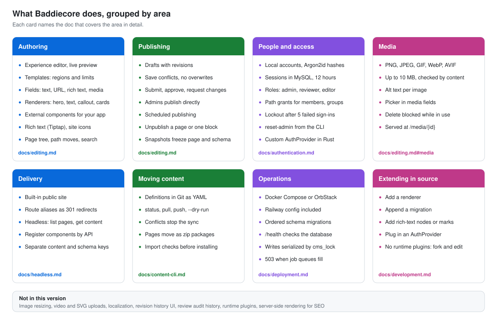

# How Baddiecore fits together

[Back to README](../README.md)

Baddiecore is one Rust binary and one MySQL database. The binary serves the editor, the public site, a headless API, and a CLI. Every write goes through the same validation code in one locked transaction.

## Architecture and data flow

- **Four ways in.** Visitors use the public routes. Your app uses the headless API with a Bearer key. Editors use the admin API with a session cookie. Operators run the CLI, which connects straight to MySQL with `DATABASE_URL`.
- **One write path.** Admin requests, CLI imports, component registration, and the scheduled publisher all call the domain core in `src/`. It validates drafts against templates and components and writes inside a transaction that holds the `cms_lock` row. `src/store.rs` is the only module that writes `pages` rows.
- **Reads skip the lock.** The public site and headless API read published snapshots, not drafts, so editing never changes the live site until someone publishes.
- **Publishing makes a snapshot.** A snapshot stores the page together with its template and component definitions. Later edits to drafts or definitions leave it unchanged.

## Feature map

| Area | Doc |
| --- | --- |
| Authoring, publishing, media, packages | [Editing and publishing](editing.md) |
| People and access | [Authentication](authentication.md) |
| Delivery to your own app | [Headless integration](headless.md) |
| Definitions in Git | [Content CLI](content-cli.md) |
| Operations | [Deployment and operations](deployment.md) |
| Extending in source | [Development and extensions](development.md) |
| JSON models and endpoints | [API contract](../CONTRACT.md) |
